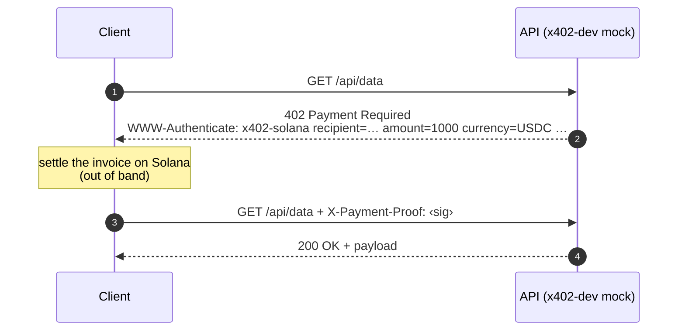

# x402-dev

[](https://github.com/valentynkit/x402_CLI/actions/workflows/test.yml)
[](LICENSE)

*A developer toolkit for HTTP 402 payment-gated APIs on Solana — mock the paywall, test it, generate the middleware.*

It bundles a mock facilitator server, a protocol-compliance checker, a YAML test
runner, and a policy-to-middleware code generator behind one CLI — so you can
build and test the server side of the **HTTP 402 ("Payment Required")** handshake
with no wallet, RPC node, or devnet in the loop. Built during a Solana hackathon.

> **A dev/test tool, not a payment processor.** The mock server issues and
> accepts invoices entirely locally — it never touches the chain and accepts any
> payment proof. See [Scope](#scope).

## The handshake it models

`402 Payment Required` is the status code the x402 scheme uses to put a paywall
in front of an HTTP route. The exchange is two phases:



A protected route answers an unpaid request with `402` and a `WWW-Authenticate:
x402-solana …` challenge describing the invoice — recipient, amount, currency,
memo, network. The client settles on Solana and retries with an `X-Payment-Proof`
header. `x402-dev` stands up the server side of that exchange so you can build
and test against it before any real settlement exists.

## Quick start

Not published to crates.io — build from source:

```sh
git clone https://github.com/valentynkit/x402_CLI
cd x402_CLI
cargo build --release                  # binary → target/release/x402-dev
cargo install --path crates/x402-cli   # optional: put x402-dev on your PATH
```

```sh
mkdir my-api && cd my-api
x402-dev init                        # writes a starter .x402dev.yaml here
x402-dev mock                        # mock 402 server on :3402

# in another shell
curl -i localhost:3402/api/data
# HTTP/1.1 402 Payment Required
# WWW-Authenticate: x402-solana recipient=Test… amount=1000 currency=USDC memo=req-… network=devnet
```

## Commands

| Command | What it does |
|---|---|
| `init` | Write a starter `.x402dev.yaml` config in the current directory |
| `mock` | Run the mock facilitator: 402 + invoice on protected routes (`stop` / `status` / `restart`) |
| `check <url>` | Probe a live URL for x402 compliance — status, headers, invoice shape |
| `test <suite.yaml>` | Run a YAML test suite; `--junit` / `--json` / `--html` reports for CI |
| `policy generate <file>` | Generate Express/Fastify middleware from a YAML policy |
| `policy validate <file>` | Check a policy file for syntax errors and rule conflicts |
| `examples` | Browse the bundled example configs and policies |
| `doctor` | Diagnose setup; `--fix` to repair |
| `config show` | Print the effective config and where each value came from |

`x402-dev <command> --help` for flags. Resolution order is CLI flags > env
(`X402_DEV_*`) > project `.x402dev.yaml` > global `~/.x402dev/config.yaml` >
defaults.

## Policy as code

A policy file describes payment rules; `policy generate` emits middleware for a
real framework instead of hand-written boilerplate:

```yaml
# policy.yaml
policies:
  - type: rate_limit
    pattern: "/api/*"
    max_requests: 100
    window: 3600
  - type: spending_cap
    pattern: "/api/premium/*"
    max_amount: 10000
    currency: USDC
```

```sh
x402-dev policy generate policy.yaml --framework express   # → middleware
```

## Testing in CI

Test suites are YAML; results export as JUnit XML for any CI runner:

```yaml
# tests/suite.yaml
tests:
  - name: protected route requires payment
    request: { url: "http://localhost:3402/api/data" }
    assertions:
      - { type: status_code, expected: 402 }
      - { type: header_exists, header: "WWW-Authenticate" }
```

```sh
x402-dev mock &
x402-dev test tests/suite.yaml --junit results.xml
```

## Project layout

A Cargo workspace, split by responsibility:

| Crate | Responsibility |
|---|---|
| `x402-domain` | Core types — amounts, pricing, validation. No I/O. |
| `x402-core` | Policy engine + Express/Fastify codegen, and the YAML test runner |
| `x402-server` | actix-web mock facilitator — the two-phase 402 handler |
| `x402-cli` | The `x402-dev` binary; command surface over the crates above |
| `x402-mcp-server` | Exposes the toolkit as MCP tools for AI agents |
| `xtask` | Workspace build / dev tasks |

## Scope

A testing and prototyping tool, stated plainly so nothing is mistaken for
production:

- **Mock only.** No Solana client, no RPC calls, no real transactions. The mock
  server accepts any `X-Payment-Proof` — it does **not** verify signatures,
  amounts, or finality.
- **No wallet / key management**, no replay protection, no balance checks.
- **Not on crates.io** — build from source (above).
- `check` validates protocol *shape* (status, headers, invoice fields), not
  on-chain settlement.

Real settlement — `solana-client` verification, a processed-signature cache, key
handling — is deliberately out of scope and left to the integrating service.

## References

- HTTP `402 Payment Required` — [RFC 9110 §15.5.3](https://www.rfc-editor.org/rfc/rfc9110#section-15.5.3)
- The `x402` payment-required scheme · [Solana docs](https://solana.com/docs)

## License

MIT — see [LICENSE](LICENSE).
